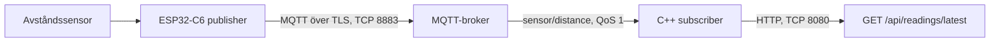

# Arkitektur

## Komponenter och dataflöde



1. ESP32-C6 läser ett avstånd från den fysiska sensorn.
2. Publishern formar mätningen som JSON och publicerar den till MQTT-topic `sensor/distance`.
3. MQTT-brokern tar emot meddelandet på TLS-port `8883` och distribuerar det till prenumeranter.
4. C++-subscribern ansluter till brokern med TLS, prenumererar på topicen och validerar varje payload.
5. Endast den senaste giltiga payloaden sparas i subscriberns minne.
6. HTTP-servern returnerar den sparade payloaden när en klient anropar API-endpointen.

## Nätverksinställningar

| Del | Protokoll | Adress/port | Användning |
|---|---|---|---|
| ESP32 → broker | MQTT över TLS | Broker `192.168.1.115`, TCP `8883` | Publicera sensorvärden |
| Subscriber → broker | MQTT över TLS | Broker `192.168.1.115`, TCP `8883` | Prenumerera på `sensor/distance` |
| Klient → subscriber | HTTP | Subscriber-IP, TCP `8080` | Hämta senaste giltiga mätning |

Broker-IP:n är en adress för den nuvarande lokala testmiljön. Den kan ändras av routern och behöver då uppdateras i konfigurationen/källkoden.

## Datakontrakt

En giltig mätning har tre fält:

```json
{
  "sensorId": 1,
  "unit": "cm",
  "value": 24.00
}
```

`sensorId` är ett heltal, `unit` är en textsträng och `value` är ett numeriskt avstånd i centimeter. Subscriber validerar JSON-syntax, fält, datatyper och tillåtna värden innan mätningen blir den senaste mätningen.

